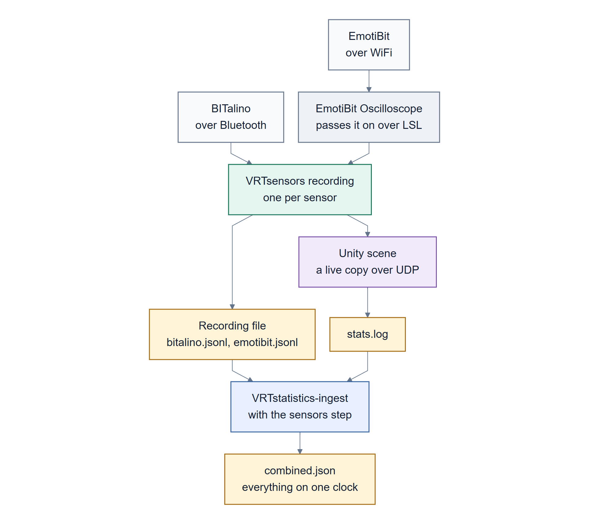
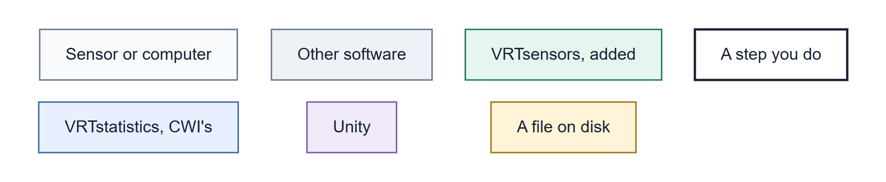

# 01 Introduction

What VR2Gather and VRTstatistics are, what this work adds to them, and the few words you'll see
throughout. If you already know both tools, skip to [What this adds](#what-this-adds).

> Part 1: Using it. [Back to contents](README.md)

## VR2Gather in a nutshell

[VR2Gather](https://github.com/cwi-dis/VR2Gather) is a Unity toolkit for **social XR**: several
people, each at their own computer and often in their own headset, sharing one virtual space.
They can see and hear each other, as live 3D video or as ordinary avatars. It's developed mainly
by the [Distributed & Interactive Systems group at CWI](https://www.dis.cwi.nl) in Amsterdam.

Four things about it matter here:

- **Every participant runs their own copy of the application**, on their own computer.
- **An orchestrator** is a central server that all the copies connect to. One participant creates
  a *session*, the others join it, and the orchestrator passes messages, audio and video between
  them.
- **Each copy writes a statistics log**, usually called `stats.log`, with lines like
  `stats: ts=…, component=…, key=value, …`. This log is how VR2Gather sessions get measured.
- **Settings live in JSON files** next to the application: `config.json` for the application and
  `config-user.json` for each user's own settings, such as their name.

## VRTstatistics in a nutshell

[VRTstatistics](https://github.com/cwi-dis/VRTstatistics) is CWI's toolkit for **running
VR2Gather sessions on several computers at once, from one place, and analysing what they
logged**. Most of it was written by Jack Jansen at CWI. It's three Python packages:

| Package | What it does |
|---|---|
| `VRTrunserver` | A small server that runs **on each participant's computer**. It receives settings, starts the VR2Gather application when told to, and sends its logs back afterwards |
| `VRTrun` | The remote control, run **on one computer** (yours). It sends every machine its settings, starts every application, and collects all the results into one folder |
| `VRTstatistics` | The analysis side. **Ingest** reads every machine's `stats.log`, puts them all on one clock, and writes a single `combined.json`. There are also tools for plots, CSV export and analysis in Python |

## Where the sensors fit

Some research questions about shared XR are about the people in it: how aroused, stressed or
engaged they are, how they move, how they react to something in the scene. Physiological
sensors can be useful in a VR2Gather study, but three things need to be true at once:

1. **The signals are recorded as part of the session**, on the same clock as everything else, so
   a heartbeat can be lined up with something that happened in the scene.
2. **With several people, every signal belongs to one person.** Two people's skin conductance must
   never get mixed up.
3. **The signals can change the scene while it runs**, not just be analysed afterwards.

## What this adds

*How a signal travels, from the sensor to one combined file.*

Four pieces, in the order the data passes through them:

1. **`VRTsensors`**, a Python package with one recording command per sensor. Each one writes the
   same kind of record, one line of JSON per sample, to a file, and can also send every record to
   Unity as it happens.
2. **A `sensors` step for ingest**, which adds those recordings to `combined.json`, on the
   session clock.
3. **A small change to `VRTrunserver`**, the only change to existing CWI code: it starts each
   machine's sensor recordings when a session starts, and stops them afterwards, so the
   recordings come back with everything else.
4. **`VRTSensors`, a set of Unity scripts** in the VR2Gather application. They receive the live
   records, keep one set of signals per participant, share them with the other participants, and
   let objects in the scene react.

Supported sensors: the **BITalino Plugged Kit** and the **EmotiBit**.

The example used throughout is **the Sleeping Giant**, a two-person scene where each person's own
body drives what they see ([05](05-the-sleeping-giant.md)). The sensor code doesn't depend on it.

### Colour key for the diagrams

Every diagram in these pages uses the same colours, which say which part of the system a box
belongs to. 

## A few words you'll see a lot

| Word | What it means |
|---|---|
| **recording** | one sensor's data from one session, saved as a `.jsonl` file. The code and the command reference call it a *capture* |
| **role** | a name for one computer's part in a session, such as `participant1`. Settings are sent per role, and results come back per role |
| **run folder** | `run-YYYYMMDD-HHMM/`, created by `VRTrun` for each session, with one sub-folder per role |
| **`runconfig.json`** | the list of roles and the network address of each role's computer |
| **sensors file** | `sensors.json` (or `sensors.local.json`): the list of recording commands a computer starts |
| **ingest** | `VRTstatistics-ingest`: logs go in, one `combined.json` comes out |
| **session clock** | each computer's clock is a little off. Ingest measures by how much and corrects for it, so every record ends up on one shared clock. `sessiontime` is seconds since the session started |
| **annotation step** | a named processing step that ingest can run. The `sensors` step is one |

---

**Next:** [02 Installing](02-installing.md)
