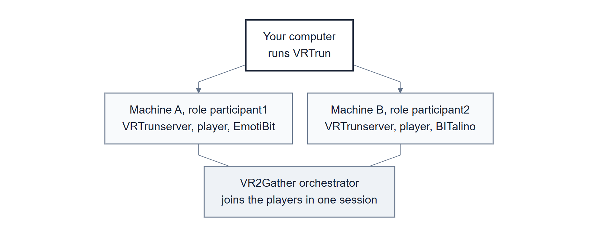
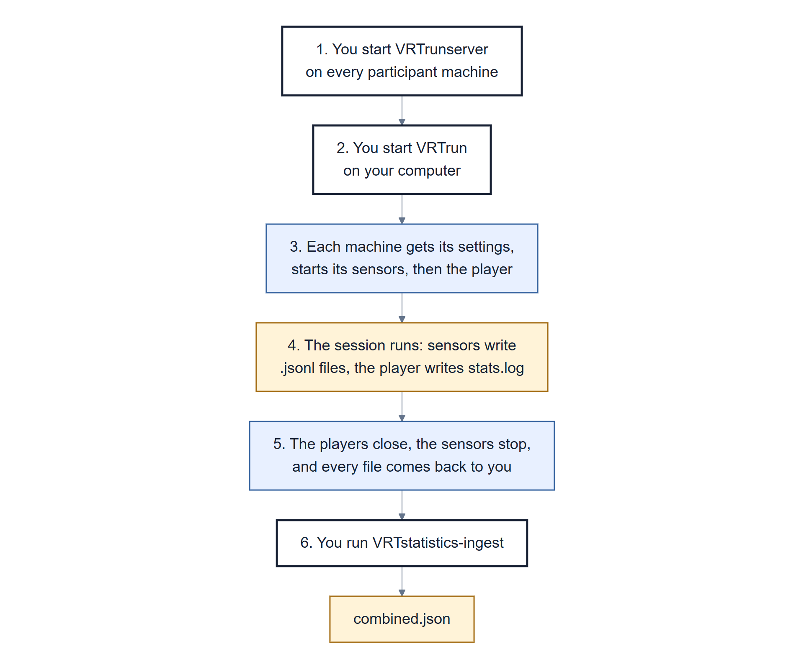

# 04 Running a session

How to record a VR2Gather session with sensors on one or more computers using `VRTrun`, where the
files end up, and how to merge them into one `combined.json`. The steps are numbered; do them in
order. (To try things out in the Unity editor instead, see
[05 The Sleeping Giant](05-the-sleeping-giant.md#on-one-computer).)

> Part 1: Using it. [Back to contents](README.md)

## The setup

<a href="figures/session-setup.svg"></a>

*You control everything from one computer. Each participant has their own machine with their own
sensor. [Colour key](01-introduction.md#colour-key-for-the-diagrams)*

Your computer can also be one of the participant machines.

## Part 1: once per computer

Do these once on **every participant machine**, and steps 1 and 4 on your own computer too.

1. **Install everything**, as in [02 Installing](02-installing.md).
2. **Copy the VR2Gather application onto it.** Build the Unity project once, on any machine
   ([05](05-the-sleeping-giant.md#getting-the-unity-project)), zip the build folder, and unzip it on
   each participant machine. Note the full path of the `.exe`; that's your `<player>`. The build
   folder also holds a `VRTrunserver.ps1` that checks the machine and starts the server for that
   player; `.\VRTrunserver.ps1 -Check`, with this repository's `.venv` active, should say `Ready`.
3. **Let `VRTrun` reach it.** `VRTrun` connects to each machine on TCP port 5002. In PowerShell
   **run as administrator**:

   ```powershell
   New-NetFirewallRule -DisplayName "VRTrunserver 5002" -Direction Inbound -Protocol TCP -LocalPort 5002 -Action Allow
   ```

4. **Check the decimal separator:**

   ```powershell
   Get-ItemProperty "HKCU:\Control Panel\International" -Name sDecimal
   ```

   It must show `sDecimal : .` If it shows a comma, change it in *Control Panel → Region →
   Additional settings → Decimal symbol*. A comma makes VR2Gather's log unreadable later
   ([06](06-checking-your-data.md#logs-written-with-a-comma-as-the-decimal-separator)).

## Part 2: prepare the settings, on your computer

1. **Copy the example settings to a folder of your own.** Don't edit them inside the repository.

   ```powershell
   Copy-Item -Recurse <repo>\examples\amplify-demo\config C:\Data\my-session\config
   ```

   What's in it is explained in [The example settings](#the-example-settings) below.

2. **Put in the machines' addresses.** On each participant machine, run `ipconfig` and note the
   **IPv4 Address** of the network adapter it's actually using (WiFi or Ethernet, not a virtual
   adapter). Put them in `runconfig.json`:

   ```json
   {
       "machines": [
           { "role": "participant1", "address": "192.168.1.20" },
           { "role": "participant2", "address": "192.168.1.21" }
       ]
   }
   ```

   Addresses handed out by a router can change from one day to the next, so check them before
   every session.

   If both machines are on WiFi, a large shared network may not pass traffic between them
   reliably: on CWI's lab WiFi the link between two laptops kept dropping for minutes at a time,
   while each laptop still reached the internet ([13](13-status.md#still-open)). A network cable,
   or a phone hotspot that both machines (and the EmotiBit) join, avoids it. On a hotspot the
   addresses change every time, so run `ipconfig` again.

3. **Say which sensors each machine has.** Each role's folder has a `sensors.json`. The EmotiBit
   needs no port, so its file usually works as it is. For the BITalino, the port belongs to the
   computer it's paired with, so do this on that computer:

   1. Copy your `participant2` folder onto the BITalino's computer (a USB stick or a zip is fine).
   2. There, run `--setup` on it. It asks what's plugged into each port and writes the answer,
      with that computer's port, into `sensors.local.json`:

      ```powershell
      VRTsensors-bitalino --address <PORT> --setup <the copied participant2 folder>
      ```

   3. Copy the new `sensors.local.json` back into `C:\Data\my-session\config\participant2\`.

   If the BITalino is paired with your own computer, point `--setup` straight at that folder.

4. **For a study, say who is recorded.** In each role's folder, copy `participant.example.json` to
   `participant.json` and put that session's pseudonymous participant ID in it (never a name):

   ```json
   {"participant": "P07"}
   ```

   Optionally put a `session.json` beside `runconfig.json` with what describes the session for
   every role, such as `{"study": "amplify-pilot", "session": "S12", "condition": "A"}`. Both
   files travel with the configuration; every recording copies them into its first line, and the
   merge puts the participant ID on every sensor record. Change them before every session.

## Part 3: record the session

<a href="figures/running-a-session.svg"></a>

*Heavy borders are the steps you do. The rest happens by itself.
[Colour key](01-introduction.md#colour-key-for-the-diagrams)*

1. **Start the server on every participant machine**, telling it where the application is. Use a
   **normal** PowerShell window, not the administrator one from Part 1: the application inherits
   the account's settings, and an administrator window, especially one opened as a different
   account, can bring back the comma decimal separator you checked in Part 1, step 4.

   ```powershell
   cd <repo>
   .venv\Scripts\Activate.ps1
   VRTrunserver --executable <player>
   ```

   It prints *"WARNING: this is a dangerous server that allows executing anything on this
   machine"*. That's normal: it does what `VRTrun` tells it to. Only run it on a network you
   trust, and close it when you're done. Leave the window open during the session.

2. **Check the sensors are ready:** each BITalino on and paired; EmotiBit Oscilloscope running,
   and `VRTsensors-emotibit --list` showing its streams. After a BITalino has been switched off
   and on, or the computer restarted, record from it once by hand on its own computer, wait for
   `connected`, and stop with Ctrl+C:

   ```powershell
   VRTsensors-bitalino --address <port> --output C:\Data\test-bitalino.jsonl --channel A1=acc
   ```

   If it never says `connected`, sort that out first
   ([08](08-troubleshooting.md#a-recording-gave-up-or-ran-much-shorter-than-expected)); a run
   started with a stuck BITalino stalls and gives up.

   Then check, from your computer, that every machine in `runconfig.json` can be reached:

   ```powershell
   Test-NetConnection <participant address> -Port 5002
   ```

   It must say `TcpTestSucceeded : True`. A ping isn't enough, and some machines don't answer
   pings at all.

3. **Start `VRTrun` on your computer**, from the folder where you want the results:

   ```powershell
   cd C:\Data\my-session
   VRTrun --config C:\Data\my-session\config
   ```

   Each server window should print which sensors file it used and one line per recording:

   ```
   run: sensors from sensors.local.json
   run: sensor command=...
   ```

   Then the VR2Gather application opens on every machine.

4. **Run the session.** With the example settings, sessions are created and joined by hand: on
   the first machine create a session with the *AMPlify: The Sleeping Giant* scenario, and on the
   other machine join it.

5. **Finish.** Quit the application on every machine. Each server stops its recordings, and
   `VRTrun` copies every machine's files into a new `run-YYYYMMDD-HHMM` folder on your computer.

6. **Merge everything into `combined.json`**, using the real name of that run folder:

   ```powershell
   VRTstatistics-ingest --norun run-YYYYMMDD-HHMM --config C:\Data\my-session\config --module VRTsensors.ingest -a sensors
   ```

   It prints each machine's clock offset, for example
   `Warning: participant2 clock -4.636s (+/- 0.008s) behind orchestrator`. Those "warnings" are
   the clock correction doing its job, not a problem.

7. **Check the result:**

   ```powershell
   VRTsensors-validate run-YYYYMMDD-HHMM
   ```

   [06 Checking your data](06-checking-your-data.md) explains the output.

## Where everything ends up

```
C:\Data\my-session\run-YYYYMMDD-HHMM\
    combined.json                      the whole session, after step 6
    participant1\
        emotibit.jsonl                 the sensor recording
        VRTsensors-emotibit-1.log      the recording's own messages
        stats.log                      the application's statistics log
        unity.log                      the application's log
        rusage.log                     CPU and memory use
        config.json  config-user.json  sensors.json  runconfig.json
    participant2\
        bitalino.jsonl
        VRTsensors-bitalino-1.log
        ...the same set
```

The settings come back on purpose: a run folder records what actually ran. Keep run folders
**outside** the repository; run data doesn't belong in git.

## Running a study: what keeps the data trustworthy

A demo only has to work on the day. A study session has to produce data you can still defend
months later. These steps are what make that possible with the current code. What they can't
fix is listed in [06](06-checking-your-data.md#what-the-timestamps-cant-tell-you) and
[13 Status](13-status.md#still-open).

**Before each session**

1. **Use a built player under `VRTrun`.** Recordings started from the Unity editor land in
   `sensor-runs/`, where ingest doesn't look ([09](09-unity.md#starting-the-recordings-from-the-editor)).
2. **Synchronise every computer's clock**, and don't touch the clocks again until the session
   ends. Ingest corrects each computer's offset once, at the start of the session, so a clock
   that is adjusted halfway through shifts everything recorded after the adjustment. In a
   PowerShell run as administrator: `w32tm /resync`, then `w32tm /query /status` to see the
   source and when it last synchronised. The checker reports how far each computer's clock moved
   during each recording, and any step as `clock stepped`.
3. **Check the sensors file every machine will use.** A `sensors.local.json` *replaces*
   `sensors.json` entirely, so a sensor listed only in `sensors.json` is not recorded. Each
   server window prints which file it used, and a `WARNING` line for any sensor that file
   leaves out ([step 3 above](#part-3-record-the-session)).
4. **Bind each EmotiBit recording to its own device.** Every computer sees every EmotiBit on the
   network, under the same stream names. Give each computer's `VRTsensors-emotibit` command
   `--source <device ID>` for the EmotiBit its participant wears, in that role's
   `sensors.local.json` (the ID is the `source` that `VRTsensors-emotibit --list` prints).
   Without it, both computers record both devices: `--study` reports it, and ingest refuses a
   participant's recording that holds two devices or a device that two participants' recordings
   hold. To prove ownership, tap one device at a time and check it appears under one role only.
5. **Start EmotiBit Oscilloscope before `VRTrun`, and don't restart it during the session.**
   A restart is survivable: the recording marks each signal `disconnected` and picks it up again
   within a few seconds of it coming back. Everything the EmotiBit sent in between is lost, so
   note the time in your participant log.
6. **Keep a participant log of your own** with the run folder name, which pseudonym was on which
   role, and anything that happened. Roles name computers, not people; the log, not the
   recordings, links a pseudonym to a person, and is kept as the study's data plan says.

**After each session**

1. **Run `VRTsensors-validate --study`** on the run folder before the participants leave, so a
   failed recording can be repeated while they're still there. Read every `!` line: a clean
   recording has none. `--study` also requires a participant ID, the current recording format
   and code that was committed when it ran.
2. **Check the merge**, as [06](06-checking-your-data.md#check-the-merge-separately)
   describes: each recording's `records` in `combined.json` should match its line count.
3. **Back up the run folder untouched** before any analysis. `combined.json` can always be made
   again from it; the recordings can't.
4. **Handle the data as personal data** ([below](#personal-data)).
5. **Allow for the size of long sessions.** Ingest holds the whole session in memory: in a test,
   a one-hour session with two participants (a BITalino and an EmotiBit each) needed about 4 GB
   of memory and produced a 1.2 GB `combined.json`.

## Personal data

What a session records about a person, and what that asks of you. The rules themselves are your
study's: its ethics approval and data management plan decide; these are the facts they need.

| Where | What it holds |
|---|---|
| `*.jsonl`, `combined.json` | physiological signals (skin conductance, heart rate, pulse, temperature, movement, muscle and brain activity, button presses), timed to the millisecond. In the EU these are health data, a special category of personal data |
| `capture` records | the pseudonym from `participant.json`, the computer's name, the command line |
| `stats.log`, `unity.log`, `config-user.json` | the `userName` typed or configured in VR2Gather: use the pseudonym there too, or leave it empty |
| your participant log | the only link from a pseudonym to a person. Keep it apart from the recordings |

- **Never put a name in a file that travels with the session**: `participant.json`, `session.json`,
  `config-user.json`, run folder names.
- **Keep run folders out of git.** The repository's `.gitignore` already excludes recordings,
  `combined.json` and run folders; don't force them in, and don't copy them into another repository.
- **Store and share run folders as the data plan says**: access-controlled storage, and only the
  people the approval names. The participant machines' `VRTrunserver-workdir` folders hold a copy
  of every session; delete them once the run folders are safely stored.
- **Withdrawal**: the pseudonym finds every file of a participant (it is on every sensor record
  after ingest, and in every `capture` record).

## The example settings

[`examples/amplify-demo/`](../examples/amplify-demo/) holds three ready-made settings folders:

| Folder | What it's for |
|---|---|
| `config/` | two machines, one participant each: `participant1` with an EmotiBit, `participant2` with a BITalino. Sessions are created and joined by hand |
| `config/self/` | a role for one machine carrying both sensors; use it with a one-entry `runconfig.json` |
| `config-single/` | one machine that runs by itself: a BITalino with EEG on `A1` and EMG on `A2`, creating the session as `participant1`, leaving after 120 s |

```
config\
    runconfig.json        the roles and the address of each role's machine
    config.json           VR2Gather settings, sent to every machine
    config-user.json      user settings, sent to every machine
    participant1\
        config-user.json  this participant's user name, microphone and avatar
        sensors.json      this participant's recordings (EmotiBit)
    participant2\
        config-user.json
        sensors.json      (BITalino)
```

A file in a role's folder replaces the shared file with the same name, for that role only. That's
how one role gets a BITalino and the other an EmotiBit.

Only three kinds of value ever need replacing: the machine addresses in `runconfig.json`, the
BITalino's port in its sensors file, and the user names in each `config-user.json` (any name,
different for each participant).

`config.json` contains one block the sensor work adds, `"SensorConfig": {"udpPort": 9010}`: the
port Unity listens on and the recordings send to.

### `sensors.json` and `sensors.local.json`

`sensors.json` is the documented default for a role and is kept in git. `sensors.local.json`, next
to it, says what's plugged into a machine today. **The local file wins when it exists**, and git
ignores it. Everything that reads these files prints which one it used, because a forgotten local
file is otherwise invisible ([08](08-troubleshooting.md#nothing-looked-wrong-but-theres-no-sensor-data)).

The local file **replaces** `sensors.json`; it doesn't add to it. That's what lets a machine leave
a sensor out, but it also means a sensor listed only in `sensors.json` won't run. Both launchers
name every such sensor in a warning: `run: WARNING: sensors.json also starts vrtsensors-emotibit,
which sensors.local.json does not; it will not run`. `--setup` copies the other commands across
when it writes a new local file, so the warning means the file was written or edited by hand.

`VRTrun` sends every file in a role's folder, so keep both files **in the role folders on your
computer**; nothing needs copying onto the participant machines by hand.

### Running one machine by hand

`config-single/config.json` starts, runs and stops by itself. To do the same by hand, change its
`AutoStartConfig` to:

```json
"autoCreateForUser": "",
"autoStartWith": -1,
"autoLeaveAfter": 0.0,
"autoStopAfterLeave": false,
"autoCreate": false
```

`autoCreateForUser` names the user who creates the session; everyone else joins. It must match a
`userName` in some role's `config-user.json`, or every application will try to join a session
nobody created.

---

**Next:** [05 The Sleeping Giant](05-the-sleeping-giant.md)
