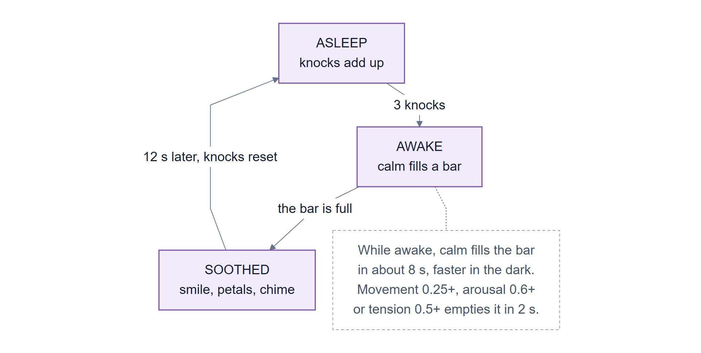
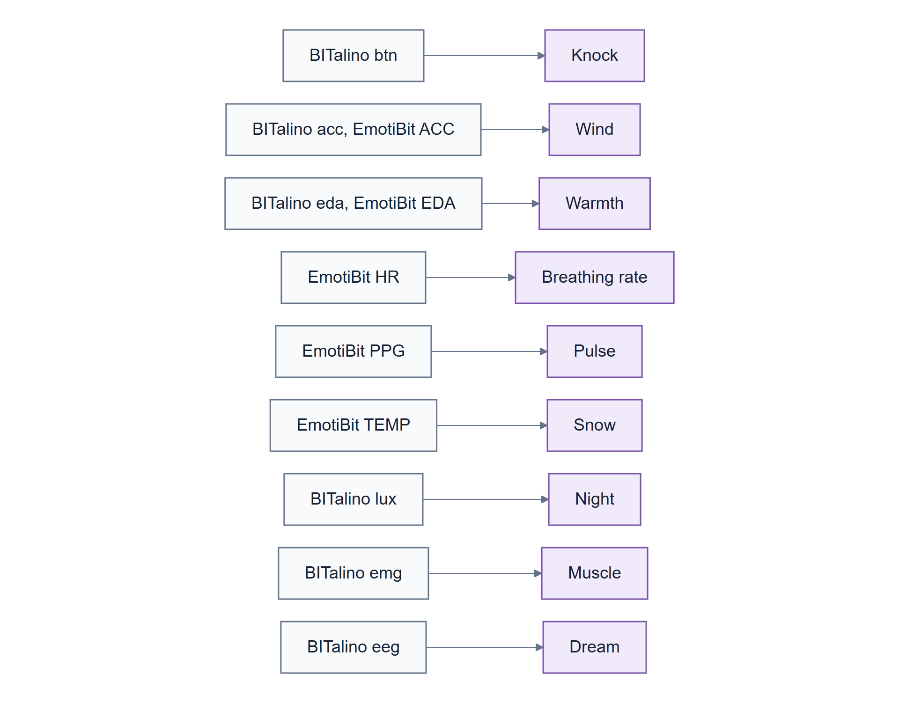

# 05 The Sleeping Giant

The demo scene: a two-person garden where each person's own body drives what they see, and a
giant they share reacts to both of them. It exercises every part of the sensor setup in a way you
can watch. It's a demo, not a study, and nothing it shows is a measurement.

This page also covers running it in the **Unity editor**, the quickest way to see everything
working. For a properly recorded session, use [04 Running a session](04-running-a-session.md).

> Part 1: Using it. [Back to contents](README.md)

## What happens in the scene

<a href="figures/demo-states.svg"></a>

*The giant wakes on three knocks and goes back to sleep once everyone stays calm.
[Colour key](01-introduction.md#colour-key-for-the-diagrams)*

A giant sleeps in a garden. Knock three times (press your button) and it wakes up. Then calm down
and stay calm, and it's soothed and goes back to sleep. Only knocks wake it; moving never does.
Knocks don't fade while it sleeps, so presses a minute apart still count.

Each person has a lantern showing their own signals. Around the garden there's one sign per
signal, saying which sensor it listens to, what to do, what's happening now, and a meter. Each sign
stands next to the thing its signal drives.

## Which signal does what

<a href="figures/signal-to-scene.svg"></a>

*Each signal has its own effect and its own sign. [Colour key](01-introduction.md#colour-key-for-the-diagrams)*

| Signal | Sensor and channel | What it does |
|---|---|---|
| Knock | BITalino `btn` on `I1`, or the **K** key | wakes the giant |
| Wind | BITalino `acc`, EmotiBit `ACC` | leaves fly, the giant frowns |
| Warmth | EmotiBit `EDA`, BITalino `eda` | the colour of the giant's cracks, blue to amber |
| Heartbeat | EmotiBit `HR` | how fast the giant breathes |
| Pulse | EmotiBit `PPG` | a heart-stone in its chest lights up with every beat |
| Snow | EmotiBit `TEMP` | cold skin makes it snow |
| Night | BITalino `lux` | cover the sensor and dusk falls |
| Muscle | BITalino `emg` | the giant clenches its fists |
| Dream | BITalino `eeg` | while it sleeps, a drift of sparks: busy mind, busy dream |

The **K** key does exactly what a real button press does, so you can try the scene with no sensors
at all. Which signals have been checked with real sensors is in [13 Status](13-status.md#per-signal).

The usual BITalino wiring is the accelerometer on `A1` and the button on `I1`. The kit has two
module cables, so to show muscle or brain activity instead, wire `emg` and `eeg` (see
[03](03-connecting-the-sensors.md#electrode-modules)).

## Getting the Unity project

The scene lives in CWI's VR2Gather sample application project,
[`cwi-dis/VR2Gather_sample`](https://github.com/cwi-dis/VR2Gather_sample), in its
`Assets/VRTSensors/` folder.

1. **Install Git LFS once**, then clone; the project's large files only arrive with LFS:

   ```powershell
   git lfs install
   git clone https://github.com/cwi-dis/VR2Gather_sample
   ```

2. **Install Unity 6000.3.10f1** through Unity Hub. The Windows build support that comes with the
   Windows editor is enough: the project builds with the default Mono backend. The project names
   that exact version (`ProjectSettings/ProjectVersion.txt`).
3. **Install cwipc**, CWI's point-cloud library, on every computer that will run the scene, as its
   own instructions say: [github.com/cwi-dis/cwipc](https://github.com/cwi-dis/cwipc).
4. **Open the project once with internet access.** Unity fetches the VR2Gather packages from
   GitHub, pinned by `Packages/packages-lock.json`, so Git must be on PATH. The first import may
   print one compile error from the cwipc package before everything has arrived; a clean
   recompile follows by itself.
5. **Check the orchestrator is reachable.** VR2Gather's sessions go through an orchestrator; the
   project's `config.json` names CWI's development server,
   `http://virtnuc-dis.spin-off.cwi.nl:8090/`. From each computer:
   `Test-NetConnection virtnuc-dis.spin-off.cwi.nl -Port 8090` must succeed, or no session can be
   created. Another orchestrator goes in `orchestratorURL` in `config.json`.
6. **To build the application** for [04](04-running-a-session.md): *File → Build Profiles →
   Windows → Build*, or without opening the editor:

   ```powershell
   & "C:\Program Files\Unity\Hub\Editor\6000.3.10f1\Editor\Unity.exe" -batchmode -quit -projectPath <project> -buildTarget Win64 -buildWindows64Player <folder>\VR2Gather.exe -logFile build.log
   ```

   The build folder gets the project's `config.json` and a `VRTrunserver.ps1` that starts this
   repository's server for that application (and refuses an older or missing one). A clean
   checkout built this way in under three minutes on the development machine.

## On one computer

You need the software installed ([02](02-installing.md)), your sensors connected
([03](03-connecting-the-sensors.md)), and the Unity project ([above](#getting-the-unity-project)).

1. **Let Unity find the recording commands.** Add the virtual environment's `Scripts` folder to
   your user PATH:

   ```powershell
   [Environment]::SetEnvironmentVariable("Path", [Environment]::GetEnvironmentVariable("Path", "User") + ";<repo>\.venv\Scripts", "User")
   ```

   Then **close Unity Hub completely and open it again.** Unity only sees the new PATH after the
   Hub restarts.
2. **Open the project** in Unity Hub (*Add → Add project from disk*, then pick the project folder).
3. **Choose your sensors.** In PowerShell, in the project folder, pick one of the ready-made
   choices. For example, a BITalino on `COM5`:

   ```powershell
   .\sensors.ps1 bitalino -Port COM5
   ```

   Other choices include `emotibit`, `bitalino+emotibit`, `bitalino-emg` and `none`. Run
   `.\sensors.ps1` on its own to list them all and see what's active. Every command should show
   `[ok]`; `[NOT ON PATH]` means step 1 hasn't taken effect yet.

   The script writes `sensors.json`. If there's also a `sensors.local.json` in the project folder,
   that one wins, so delete it unless you put it there on purpose.
4. **Press Play** on the `VRTLoginManager` scene.
5. **Check the Console:** one `SensorCaptures: started …` line per sensor, and a line saying which
   sensors file was used. A red `SensorCaptures:` line means nothing is recording
   ([08](08-troubleshooting.md#unity-shows-a-red-sensorcaptures-line)).
6. **Create a session** with the *AMPlify: The Sleeping Giant* scenario.

## On two computers

One participant per computer, each with their own sensor:

| | Computer A | Computer B |
|---|---|---|
| Sensor | EmotiBit | BITalino, on that computer's own port |
| Sensors choice | `.\sensors.ps1 emotibit` | `.\sensors.ps1 bitalino -Port <PORT>` |
| In the session | creates it | joins it |

Follow "On one computer" on both. Each computer lists only its own sensor and receives its own
recordings on `127.0.0.1`, so they don't collide; only `SensorShare`'s snapshots cross the network.

## Trying it out

1. Once both people have joined, wait about 15 seconds, standing still, so the scene can learn
   resting levels.
2. On computer B, press the button three times, about a second apart. **Both** giants should wake
   on the third press, together.
3. Move each sensor in turn. The wind should follow whoever is moving.
4. Look at the sensor board: one column per person, each showing only that person's sensor.
5. With an EMG or EEG module wired, tense the muscle while the other computer watches. The local
   and the remote meter should move together.
6. Unplug an electrode while the scene runs. Its sign must say `Lost your BITalino …` and its
   effect must stop, rather than showing a calm reading.
7. Sit still for about 30 seconds and let the giant be soothed.

## After every session in the editor

In the editor, VR2Gather **overwrites `stats.log` every time you press Play**. It's in
`%USERPROFILE%\AppData\LocalLow\<company>\<product>\stats.log`. Copy it somewhere safe before the
next Play, on every computer. With `VRTrun` this is done for you.

---

**Next:** [06 Checking your data](06-checking-your-data.md)
