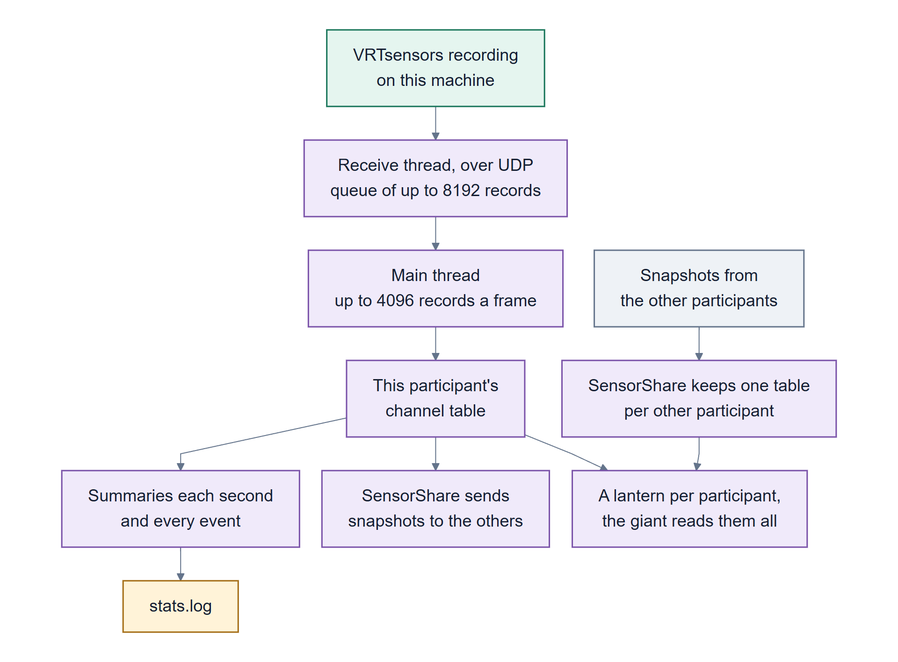

# 09 Unity

How to get sensor data into **your own** VR2Gather scene: receiving the records, keeping each
participant's signals separate, sharing them with the others, and reading them from your scripts.
To run the ready-made demo instead, see [05 The Sleeping Giant](05-the-sleeping-giant.md).

> Part 2: Building on it. [Back to contents](README.md)

## Where the code is

The Unity code **isn't in this repository**. It's a folder of C# scripts, `Assets/VRTSensors/`, in
CWI's VR2Gather sample application project, `cwi-dis/VR2Gather_sample`. It was
built with Unity 6000.3 and the VR2Gather package from its git master. Nothing in the VR2Gather
package itself was changed.

## The pieces

<a href="figures/unity-internals.svg"></a>

*Records arrive over UDP, land in this participant's table, and are shared with the others as
snapshots. [Colour key](01-introduction.md#colour-key-for-the-diagrams)*

The folder holds two different things: a **sensor layer** that works in any VR2Gather scene, and
**the Sleeping Giant demo**, which is one scene built on top of it.

**The sensor layer: what any scene needs.**

| Script | What it does |
|---|---|
| `SensorStream` | Receives the records over UDP, turns them into named channels in one table per participant, and summarises them in `stats.log`. Creates itself before the first scene loads, so a scene needs no setup |
| `SensorJson` | Reads one record |
| `SensorShare` | Sends each participant's channels to the others over the session, and keeps one table per other participant. Add it to an object in a multi-person scene |
| `Editor/SensorCaptures` | Starts the recordings when you press Play in the editor, and stops them when Play ends |
| `Editor/SensorRunserverScript` | Writes the `VRTrunserver.ps1` that every Windows build carries |

**The Sleeping Giant demo: only for that scene** ([05](05-the-sleeping-giant.md)).

| Script or asset | What it does |
|---|---|
| `Scenes/AMPlifySensorDemo.unity`, `Materials/` | The scene: the garden, the giant, the signs, the lantern, the board, all saved in the scene and edited in the editor like any other |
| `SensorScenario` | Adds *AMPlify: The Sleeping Giant* to the scenario list when a session is created |
| `CalmLantern` | Turns one participant's channels into a few derived signals (arousal, heart rate, movement and so on) and shows them on their lantern. Everything else in the demo reads these |
| `SleepingGiant`, `SensorGarden`, `WeatherSwarm`, `GardenSignpost` | The giant, the garden around it, each participant's fireflies, the nine signs |
| `SensorBoard` | The diagnostic board: whose devices are sending, every channel, what goes into `stats.log` |
| `GardenPalette`, `GrabToMove`, `FaceViewer` | The demo's colours, moving the board with a controller, labels that turn to face you |
| `Editor/SensorSetup` | **VR2Gather → Sensors → Add sensor rig to open scene**: puts a lantern and a board into another scene |

There's one tie between the two: when the scene has a lantern, `SensorShare` gives every other
participant a copy of it. Without one, it only shares the data.

**What's created while the scene runs.** The level is saved in the scene, not built by a script.
Only things that depend on who's there are made at run time: a copy of the lantern, with a name
over it, for each participant who joins; the board's panels and text, which it lays out when
Play starts and grows by one column per device that's sending (the board object itself is in the
scene); and `SensorStream`'s own object.

## Adding it to your project

1. **Copy `Assets/VRTSensors/`** into your VR2Gather project.
2. **Pick the port (optional).** Unity listens on UDP 9010. To change it, add this to the project's
   `config.json`, and use the same port in the recordings' `--udp`:

   ```json
   "SensorConfig": {
       "udpPort": 9010
   }
   ```

3. **Press Play.** `SensorStream` creates itself before the first scene loads and keeps listening
   in every scene. Start a recording with `--udp 127.0.0.1:9010` and its channels appear.
4. **For sessions with several people, add a `SensorShare` component** to an object in the scene
   that runs the session.
5. **Read signals in your own scripts** from a participant's table:

   ```csharp
   public string participant = "";   // empty: the person at this computer; otherwise a VR2Gather user id
   SensorStream.Table Table => SensorShare.TableFor(participant);

   void Update()
   {
       SensorStream.Channel eda = Table?.Find("emotibit.EDA");   // null until it arrives
       if (eda != null && eda.Available) Use(eda.value);
   }
   ```

To try the demo's building blocks in your scene, use **VR2Gather → Sensors → Add sensor rig to open
scene**.

## Starting the recordings from the editor

`Editor/SensorCaptures` starts every command in the sensors file next to the project's
`config.json` when you press Play, and stops them when Play stops: it closes their input and gives
them five seconds to finish, as the server does, before killing what's left. It follows the same rule as the
server: `sensors.local.json` if there is one, otherwise `sensors.json`. Each Play writes into a new
folder, `<config folder>/sensor-runs/<time>-<id>/`, so nothing is overwritten.

Unity looks the commands up on its own PATH, which it gets from Unity Hub. How to set it up is in
[05](05-the-sleeping-giant.md#on-one-computer). In a built player this tool doesn't exist;
`VRTrunserver` starts the recordings instead, and the `VRTrunserver.ps1` written into every
Windows build (by `Editor/SensorRunserverScript`) starts that server for the build, refusing a
missing or older one: it checks that the `VRTrunserver` module the environment would import
declares `SENSOR_SUPPORT` 2, so a server from before sensor support earlier on the path is refused too.

An editor Play is for building and demonstrating a scene, not for a study. Its recordings land in
`sensor-runs/`, not beside a role's `stats.log`, so `VRTstatistics-ingest` doesn't find them. A
session meant for analysis is a built player run under `VRTrun`
([04](04-running-a-session.md)).

## Channels

**Every number in a record becomes a channel**, named after the sensor and field, with the device
in the name so two devices never mix: `bitalino@<device>.acc`, `emotibit.EDA@<source_id>.value`. A
short name like `bitalino.acc` also works, as long as only one device matches it.

| Field | What it holds |
|---|---|
| `value`, `previous` | the latest value and the one before |
| `min`, `max` | lowest and highest in the current one-second window |
| `lo`, `hi` | the display range: widened by each sample, eased back over about 30 s |
| `presses` | how many button presses so far; only goes up |
| `rate`, `Status` | measured samples per second; `Live`, `Waiting`, `Stale`, `Last event`, or the connection state |
| `kind` | what the recording says this channel is, from its port's name |
| `baseline`, `envelope` | the resting level, and how far the signal swings from it |

**Logging.** Into the same `stats.log` VR2Gather already writes: one summary line per channel per
second, and every sensor event. Another participant's data is never logged on your computer.

**Freshness.** A regular stream counts as stale after five seconds of silence. Irregular streams,
like heart rate, show "Last event" and its age instead.

## Activity: worked out for every sample

For muscle (EMG) and brain (EEG), the level itself isn't much use; a scene wants **how far the
signal is swinging from its resting level**. That's worked out on the channel, for every sample:

| Constant | Value | What it does |
|---|---:|---|
| `BaselineTimeConstant` | 2 s | how quickly the resting level follows the signal |
| `EnvelopeDecay` | 0.4 s | how quickly a swing fades |

```csharp
float counts = c.Envelope;       // the swing right now, in the signal's own units
float level = c.Activity(600f);  // the same, as 0..1 against a full scale you choose
```

It has to be per sample: at 100 samples a second, a whole twitch can start and end inside one
frame, and a once-a-frame reading would miss it. Why, in more detail:
[11 How it works](11-how-it-works.md#features-are-worked-out-where-the-samples-are).

## Sharing between participants

`SensorShare` sends a small **snapshot** of the local participant's channels over VR2Gather's
session messages every 0.5 s (`SensorShare.interval`), and straight away after a press. The
snapshot includes the activity envelope, because a remote computer seeing two values a second
can't work it out itself.

Each snapshot goes into **that participant's table**, keyed by their VR2Gather user id. A scene
object reads only the table of the participant it follows, so it can't pick up the wrong person's
signals. Give `SensorShare` a template object and it makes one copy per other participant.

## Showing that a sensor is lost

A scene should ask "is this channel arriving right now?", not "is a channel set?". The demo's
`CalmLantern.Arriving(key)` does that, so a sign can say three different things:

```
Waiting for your BITalino brain sensor...                 nothing has ever arrived
Lost your BITalino brain sensor - it has stopped sending  it arrived, and has now stopped
A quiet mind - a quiet dream                              arriving, and genuinely quiet
```

Otherwise an unplugged electrode looks exactly like a calm participant.

---

**Next:** [10 Command reference](10-command-reference.md)
