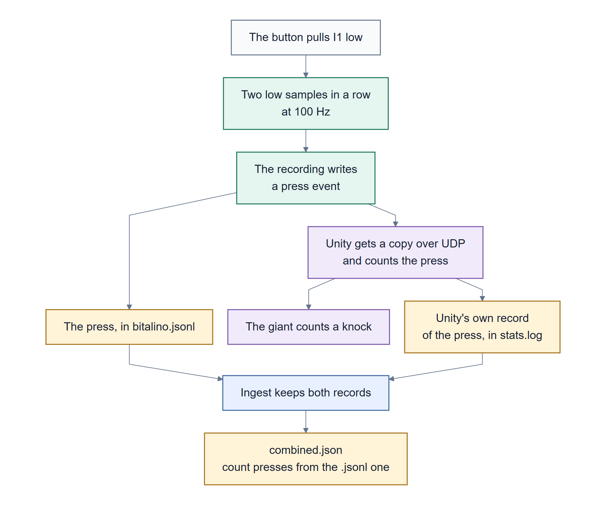
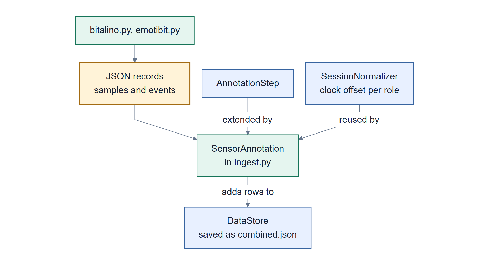

# 11 How it works

The design, and why each choice was made. The overall picture is the system
map in [01 Introduction](01-introduction.md#what-this-adds).

> Part 3: Reviewing it. [Back to contents](README.md)

## Two paths out of every recording

Each recording sends its data two ways, and they're deliberately different:

- **The file is the record.** Written on the same computer, saved after every line, never
  overwritten. Everything afterwards is built from it.
- **UDP is a live view.** Sent to Unity on the same computer, with no confirmation and no retries.
  If Unity is slow or crashed, those copies are lost, and the file is untouched.

A live view that waits to guarantee delivery stops being live; a record that drops samples under
load stops being a record. So they get different mechanisms.

## The design choices

### One module per sensor, one kind of record

Each sensor has its own Python module that only knows its own hardware: `bitalino.py` and
`emotibit.py`. Both write the same flat record: `sensor`, `timestamp`, a device identity, and named
values. Everything downstream relies only on those common fields, so a new sensor touches no
existing code. The cost is that each sensor's quirks must be dealt with inside its own module,
which is why `bitalino.py` is the longest.

### Records are what VRTstatistics already handles

No new format and no new store. A sensor record is the same kind of flat record the pipeline
already reads from `stats.log`, which is why the whole connection to ingest is about 130 lines.

### A participant's sensors stay on that participant's computer

Raw sensor data never crosses the network. Each computer is one person, so sending raw streams
between computers would mean working out whose data is whose at the far end, and would put
physiological data on the network for no benefit. What crosses is a small snapshot of each
participant's state, twice a second, over VR2Gather's own session messages: no second connection to
set up or secure.

### Whose signal is whose is decided by where it's stored

A **role** names a computer, and every file from that computer lands in `run-…/<role>/`. A
recording is looked for there, next to that role's `stats.log`, and gets that computer's clock
correction. There's no separate list of which sensor belongs to whom that could get out of date.
Unity does the same: one table per participant, keyed by VR2Gather user id.

The assumption, said plainly: **one participant per computer.**

### The sensor's own counter spots lost samples, and timing spots the rest

Every BITalino sample carries the board's 4-bit counter, `seq`, which doesn't depend on any
computer's clock. It wraps every 16 samples, so on its own a loss of exactly 16 can't be seen.
The sample clock below can: after such a loss every batch arrives a cycle later than its count
says, and once that has held for two seconds at 100 Hz (longer at lower rates) the cycles are counted, the numbering moves on, and a
`gap` with `detected: timing` says so.

### BITalino samples are dated by count, not by arrival

PLUX's library hands samples over in batches, and Bluetooth delays each batch differently: on our
recordings by up to 175 ms. Dating a sample from its batch's arrival puts that delay into its
timestamp. So each sample is dated by its number since the connection opened, on a line fitted
under the arrivals: the period from the board's own rate over the whole connection, the start from
the batches delayed least. A batch can be late but never early, so the earliest arrivals are the
best evidence of when sampling happened. The fitted start moves by at most half a period per
sample, so timestamps never step back. Replayed through this clock, six real recordings show no
false losses and no steps back; in simulation, timestamps are within 3.5 ms of the true sample time
for 99% of samples, against 140 ms before.

The line is fitted on the performance counter, which nothing adjusts, and put on the wall clock
with one mapping taken when the connection opens (at an edge of the wall clock's 15.6 ms steps on
Windows, so the mapping itself is exact). A time synchronisation that steps the wall clock during
a connection would otherwise look like every later batch arriving late, and the clock would count
the shift as lost cycles of 16 samples: 48 for half a second.

### Ports are named, never guessed

The BITalino can't tell which module is plugged in, so only named analog ports are recorded.
Guessing from the signal was tried and dropped: an empty analog port picks up a few percent of the
port before it. On the development board, a released button on `A2` read `0.030 × A1 − 1.65` while
`A1` carried an accelerometer (R² 0.96 over 245,000 samples). No threshold can tell that from a
real signal. The button is refused anywhere but a digital input, in code rather than in a note.

### Button presses are spotted during recording

At 100 samples a second, a press can last two samples, which something checking once per video
frame would miss. So the recording checks every sample and writes `press` events. A scene then
reacts to a count that only goes up, which stays reliable across the network.

### Events and samples are one ordered stream

A dropout, a gap and a press are lines in the same file as the samples, in the order they
happened. A dropout shows up as a `disconnected` event, not as an unexplained hole. An event caused
by a sample is written after it.

### Each computer's sensors are listed in one file

The same sensors file serves `VRTrunserver` and the Unity editor, so a recording that works in one
works in the other. There are two files because there are two questions: `sensors.json`, in git, is
a role's documented default; `sensors.local.json`, ignored by git, is what's plugged in today and
wins. Keeping them apart stops one day's wiring being committed over an example. Because a stale
local file is invisible, everything that reads them says which one it used. The server keeps its
own five-line copy of that rule, so it doesn't need the sensor package; a test checks the copies
agree.

### Clock correction is the pipeline's job

Each recording stamps records with its own computer's clock. Ingest already measures each role's
offset for `stats.log`, and the sensor step applies **the same offset**. There's no second scheme
to disagree with the first. So "the streams line up after ingest" is arithmetic, not evidence: to
show two streams agree, compare a physical event visible in both, such as a button press also in
Unity's log.

### Features are worked out where the samples are

How far a muscle or brain signal swings from rest is worked out in Unity, per sample, on the
computer with the sensor, and sent in the snapshot. Worked out anywhere else it fails twice:

- **At frame rate, most samples are never seen.** A whole twitch can start and end inside one
  frame; if the frame ends at rest, reading the last value shows nothing.
- **On a remote computer, two values a second arrive.** In a controlled test, a remote computer
  working from half-second snapshots of a 100 Hz ±300-count oscillation reports 0.000, while the
  computer with the sensor reports 0.502. That's a different signal, not a delay.

The rule: work it out as close to the data as possible, send the result, and leave only
presentation to the receiver.

### "Which channel" and "is it arriving" are separate questions

A scene remembers which channel it shows after it goes quiet, so a sign can still say what it's
for. Whether it's arriving now is asked separately, and gates every effect. Otherwise an unplugged
electrode would look exactly like a calm participant.

## Following one button press

*One press ends up recorded twice: once by the recording, once by Unity. Count the first.
[Colour key](01-introduction.md#colour-key-for-the-diagrams)*

## How the ingest step plugs in

*The sensor step reuses VRTstatistics' own extension point and clock correction.
[Colour key](01-introduction.md#colour-key-for-the-diagrams)*

## Patterns worth knowing before reading the code

| Pattern | Where | Why |
|---|---|---|
| An event written after the sample that caused it | `BitalinoSource.read()` | the value is already there when the event arrives |
| One output path for every recording | `open_capture`, `record_sink` | never overwrite, save every line, send the live copy: in one place |
| Recording time and connecting time counted separately | `BitalinoSource.run()` | otherwise the Bluetooth handshake eats into the recording |
| Stop and release attempted separately | `BitalinoSource.close()` | PLUX's library fails on `stop()` exactly when the device is gone |
| Feature worked out per sample, then passed on | Unity `SensorStream.Channel` | a burst inside one frame is real |
| Remembered channel, separate "is it arriving" | Unity `CalmLantern.Arriving()` | a dead sensor must not look like a calm person |
| Errors that say how to fix them | port naming, PATH, missing player | the message says what to do |

## What's deliberately left open

This code promises no sampling rate, delay, synchronisation accuracy or physiological unit; those
belong to a study's design. Every number in these pages is something seen in a named run
([13 Status](13-status.md)), not a specification. The capture format is versioned (`format` in
the `capture` record), but no schema file checks the fields.

---

**Next:** [12 For reviewers](12-for-reviewers.md)
